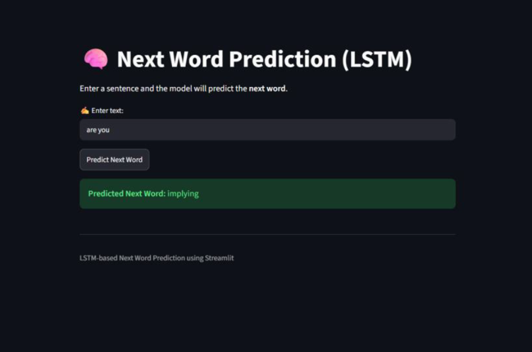
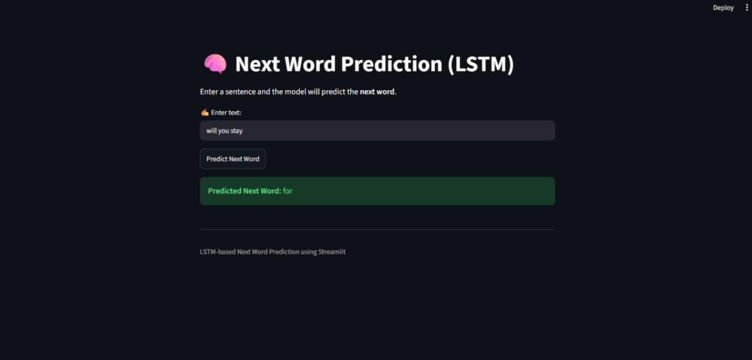

# 🧠 WordWise AI — LSTM-Powered Text Autocomplete

**Predict the next word. Keep your thoughts flowing.**

WordWise AI is a deep learning project that predicts the next word based on user-provided text using a trained Long Short-Term Memory (LSTM) neural network. It combines TensorFlow/Keras with a simple Streamlit interface to demonstrate how sequence-based language prediction works in practice.

The project covers the complete workflow, from model development and training to saving the trained model and deploying it in an interactive web application.

## ✨ Features

- **Next-Word Prediction:** Predicts the most likely next word based on the input text.
- **LSTM Neural Network:** Uses an LSTM model to learn patterns in text sequences.
- **Text Tokenization:** Converts text into numerical sequences for model input.
- **Sequence Padding:** Prepares input sequences in the format expected by the model.
- **Interactive Web Interface:** Provides a simple interface built with Streamlit.
- **Model Persistence:** Loads the saved model and preprocessing artifacts without retraining on every app launch.

## 🛠️ Tech Stack

| Technology | Purpose |
|---|---|
| Python | Core programming language |
| TensorFlow / Keras | Deep learning model development and inference |
| LSTM | Sequential text prediction |
| NumPy | Numerical operations and prediction selection |
| Pickle | Saving and loading preprocessing objects |
| Streamlit | Interactive web application |
| Jupyter Notebook | Model development and experimentation |

## 🖥️ Application Preview

### 1. WordWise AI Interface

The application allows users to enter a sentence and request a next-word prediction.



### 2. Next-Word Prediction

Example of the application displaying its predicted next word.



> **Note:** Add your actual application screenshots to the `assets/` folder using the filenames shown above. These image paths are placeholders until you upload the screenshots.

## ⚙️ How It Works

The prediction pipeline follows these steps:

1. **User Input:** The user enters text in the Streamlit interface.
2. **Tokenization:** The tokenizer converts the input text into numerical word IDs.
3. **Sequence Padding:** The input sequence is padded to the expected length.
4. **Model Inference:** The trained LSTM model calculates prediction scores for possible next words.
5. **Word Selection:** The word associated with the highest prediction score is selected.
6. **Display Prediction:** The predicted word is displayed in the application.

## 📂 Project Structure

```text
WordWise-AI/
│
├── app.py                 # Streamlit application
├── next_word_pred.ipynb   # Model development notebook
├── lstm_model.h5          # Saved trained LSTM model
├── tokenizer.pkl          # Saved tokenizer
├── max_len.pkl            # Saved sequence-length configuration
├── requirements.txt       # Python dependencies
├── README.md              # Project documentation
│
└── assets/
    ├── wordwise-interface.png
    └── wordwise-prediction.png
```

## 🚀 Getting Started

### Prerequisites

- Python installed on your system
- Git
- A compatible TensorFlow environment

### 1. Clone the Repository

```bash
git clone https://github.com/YOUR_GITHUB_USERNAME/WordWise-AI.git
cd WordWise-AI
```

### 2. Create a Virtual Environment

```bash
python -m venv .venv
```

Activate it on Ubuntu or WSL:

```bash
source .venv/bin/activate
```

On Windows PowerShell:

```powershell
.venv\Scripts\Activate.ps1
```

### 3. Install Dependencies

Create a `requirements.txt` file containing the dependencies compatible with your working environment. The core packages used by the application are:

```text
streamlit
numpy
tensorflow
```

Install them with:

```bash
python -m pip install -r requirements.txt
```

For reproducible results, use package versions tested with your saved model and Python environment.

### 4. Run the Application

Ensure that `app.py`, `lstm_model.h5`, `tokenizer.pkl`, and `max_len.pkl` are available in the expected project directory.

Run:

```bash
python -m streamlit run app.py
```

Streamlit will provide a local URL in the terminal. Open it in your browser to use WordWise AI.

## 💡 Example

**Input text:**

```text
are you a
```

**Example output:**

```text
beautiful
```

The predicted word depends on the trained model and its learned vocabulary. Your actual result may differ.

## 📚 Learning Outcomes

Through this project, I explored:

- Building a deep learning model for sequential text prediction.
- Understanding the role of LSTM networks in sequence modelling.
- Converting text into numerical input using tokenization.
- Preparing sequences with padding.
- Saving and reloading trained models and preprocessing objects.
- Integrating a trained model into a Streamlit application.

## 🔮 Future Improvements

- Display multiple candidate next words with their scores.
- Add interactive suggestions while the user types.
- Improve prediction quality through further training and evaluation.
- Experiment with larger datasets and alternative sequence models.
- Deploy the application so it can be accessed online.

## 👨‍💻 Author

**Shreyash More**

- GitHub: [Shreyash6105](https://github.com/Shreyash6105)

---

*WordWise AI — A hands-on deep learning project exploring LSTM-based next-word prediction and interactive text autocomplete.*